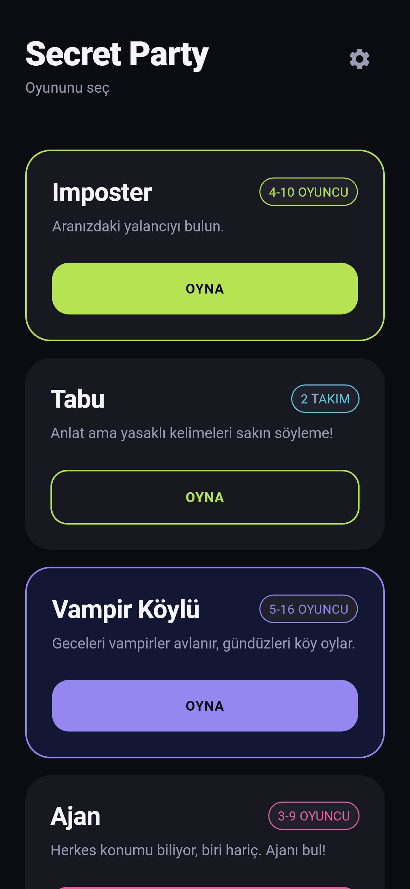
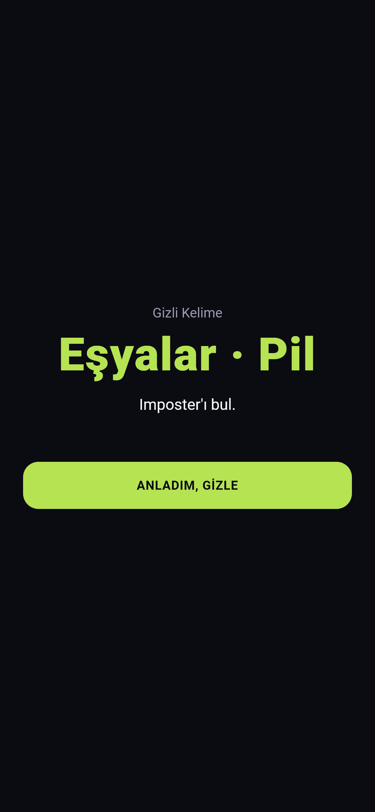
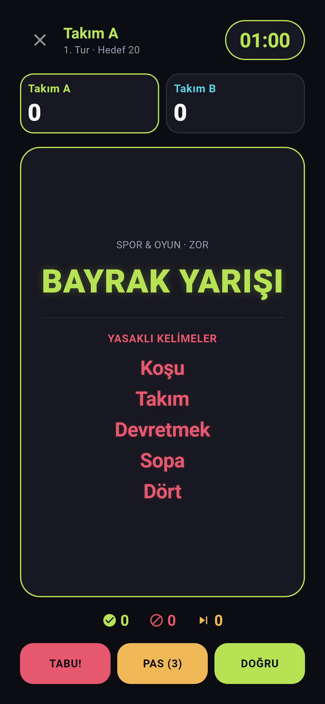
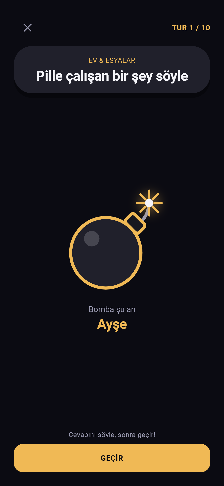
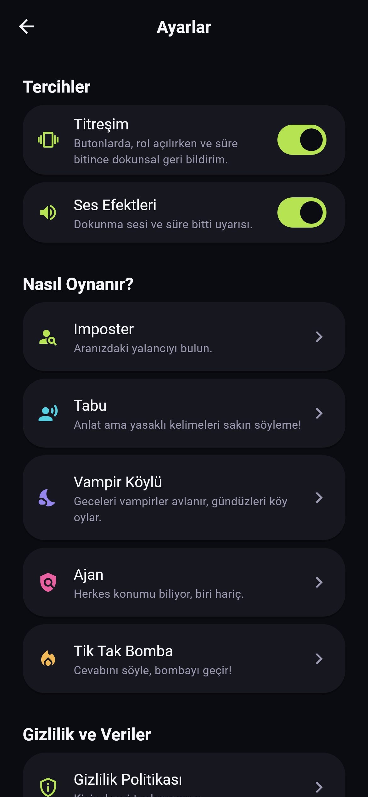

# Secret Party 🎉

**Tek telefon, bir grup arkadaş, beş parti oyunu.**
Telefonu ortaya koy, rolleri dağıt, blöf yap, aranızdaki yalancıyı bul.
İnternet yok, hesap yok, reklam yok — sadece oyun.

<p align="center">
  
  
  
  
  
</p>

## Oyunlar

| Oyun | Oyuncu | Kısaca |
|---|---|---|
| 🕵️ **Imposter** | 4–10 | Herkes gizli kelimeyi bilir, biri hariç. Sırayla ipucu verin, yalancıyı oylayarak bulun. 12 kategoride 1500+ kelime; istersen Imposter'a küçük bir ipucu. |
| 🗣️ **Tabu** | 2 takım | Kelimeyi anlat ama 5 yasaklı kelimeyi sakın söyleme! 8 kategoride 550+ kart, üç zorluk seviyesi. |
| 🧛 **Vampir Köylü** | 5–16 | Geceleri vampirler avlanır, gündüzleri köy oylar. Kâhin, doktor, cadı ve avcı rolleriyle. |
| 🗺️ **Ajan** | 3–9 | Herkes konumu biliyor, ajan hariç. Soru sor, cevapları dinle, ajanı yakala. |
| 💣 **Tik Tak Bomba** | 3–10 | Göreve bir cevap söyle, bombayı yanındakine geçir. Fitil gizli; patladığında telefon kimdeyse o yanar! |

## Neden farklı?

- **Tek cihazla oynanır:** Rol kartları basılı tutunca açılır, telefon el değiştirirken gizli bilgi korunur; uygulama arka plana atılınca kart kendiliğinden kapanır.
- **Aynı kelime iki kere gelmez:** Oynanan kelime, kart ve görevler hatırlanır; havuz bitmeden tekrar yok.
- **Parti modunda ekran kararmaz,** titreşim ve sesler sayaçla senkron çalışır (istersen kapatırsın).
- **Erişilebilir:** Büyük yazı boyutu, ekran okuyucu etiketleri, "hareketi azalt" desteği ve WCAG AA kontrastı.
- **Gizlilik:** Hiçbir veri toplanmaz, hiçbir sunucuya bağlanmaz. Oyuncu isimleri ve ayarlar yalnızca cihazda kalır.

## Çalıştırma

[Flutter](https://docs.flutter.dev/get-started/install) (Dart 3.3+) kurulu olmalı.

```bash
git clone https://github.com/mUmut2/secret-party.git
cd secret-party
flutter pub get
flutter run
```

Testler ve statik analiz:

```bash
flutter analyze
flutter test
```

## Teknik

- **Flutter** + **Riverpod** (durum yönetimi) + **GoRouter** (yönlendirme)
- Oyun kuralları saf Dart motorlarında (`lib/domain`), arayüzden bağımsız ve birim testli
- Kendi tasarım sistemi: renk, yazı, boşluk ve animasyon token'ları (`lib/core/theme`)
- Küçük telefon (320×568) ve büyük yazı boyutu için taşma testleri, içerik kalite testleri (tekrar, ipucu sızıntısı, uygunsuz içerik)

```
lib/
├── app/        # kök widget, hata yakalama, oturum yönetimi
├── core/       # tema, yönlendirme, ortak bileşenler, servisler
├── data/       # yerel depolama ve oyun içerikleri
├── domain/     # modeller ve oyun motorları (saf Dart)
└── features/   # her oyunun ekranları ve durum yönetimi
```

## Gizlilik

Uygulama kişisel veri toplamaz. Ayrıntılar: [gizlilik politikası](docs/gizlilik-politikasi.html).

## Not

Oyun içeriğinde geçen film, dizi, ünlü ve marka adları yalnızca oyun içeriği olarak anılır ve ilgili hak sahiplerine aittir; bu proje onlarla bağlantılı değildir.

Tüm hakları saklıdır.
